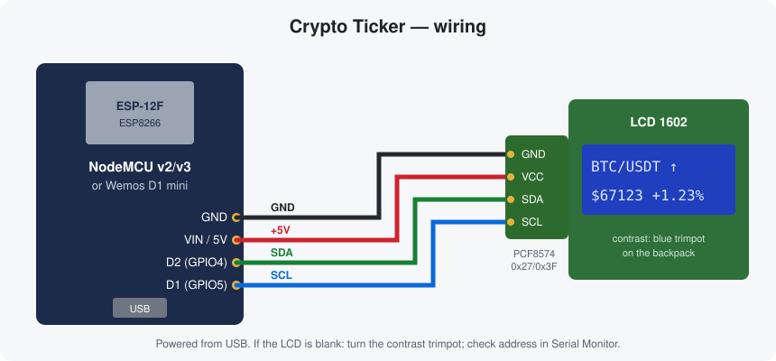

# Crypto Ticker на ESP8266

Настольный крипто-тикер: ESP8266 раз в 5 секунд берёт цену с Bybit и показывает её на LCD 1602 по I2C — пара, стрелка направления, цена и изменение за 24 часа. WiFi и монета настраиваются через встроенную веб-страницу, без перепрошивки.

```
┌────────────────┐
│BTC/USDT      ↑📶│
│$67123   +1.23% │
└────────────────┘
```

## Возможности

- Любая спотовая пара к USDT с Bybit (список монет подтягивается прямо в браузере, есть офлайн-список).
- Цена + изменение за 24 часа, стрелка роста/падения относительно прошлого обновления.
- Настройка через веб-интерфейс: поиск монеты, сканирование WiFi-сетей, смена монеты без перезагрузки.
- Точка доступа для первичной настройки, автоматический возврат в неё, если домашний WiFi пропал больше чем на минуту, и периодические попытки переподключиться.
- Доступ по `http://cryptoticker.local` (mDNS) или по IP, который показывается на экране.
- Резервный хост API: `api.bybit.com` → `api.bytick.com` (официальный альтернативный домен Bybit) при недоступности или блокировке.
- Автоопределение I2C-адреса дисплея (0x27, 0x3F и др.).

## Железо

| Компонент | Примечание |
|---|---|
| ESP8266: NodeMCU v2/v3 или Wemos D1 mini | любая плата с ESP-12 |
| LCD 1602 с I2C-переходником PCF8574 | синий/зелёный, адрес 0x27 или 0x3F |
| 4 провода Dupont «мама-мама» | |
| Кабель micro-USB / USB-C | питание и прошивка |

## Схема подключения



| LCD (PCF8574) | NodeMCU / D1 mini | GPIO |
|---|---|---|
| GND | GND | — |
| VCC | VIN (NodeMCU) / 5V (D1 mini) | — |
| SDA | D2 | GPIO4 |
| SCL | D1 | GPIO5 |

Дисплею нужно 5 В, иначе текст еле виден. Подтяжки SDA/SCL на переходнике при этом тоже тянут линии к 5 В; на практике ESP8266 это переносит, и так собрано большинство подобных проектов. Если хочется по-честному — выпаяйте два резистора подтяжки 4.7 кОм на переходнике (ESP подтянет линии к 3.3 В сама) или поставьте преобразователь уровней.

Если экран светится, но символов нет — покрутите синий подстроечник контраста на переходнике.

## Прошивка

### Arduino IDE

1. **Файл → Настройки → Дополнительные ссылки для менеджера плат:**
   `https://arduino.esp8266.com/stable/package_esp8266com_index.json`
   Затем **Инструменты → Плата → Менеджер плат** → установить **esp8266**.
2. **Менеджер библиотек** — установить:
   - `ArduinoJson` (Benoit Blanchon), версия 7+
   - `ESP Async WebServer` (ESP32Async)
   - `ESP Async TCP` (ESP32Async)
   - `LiquidCrystal I2C` (Frank de Brabander) — подойдёт и форк с GitHub, код поддерживает оба варианта
3. Открыть `CryptoTicker/CryptoTicker.ino`.
4. **Инструменты:** плата `LOLIN(WEMOS) D1 R2 & mini` или `NodeMCU 1.0 (ESP-12E Module)`, **CPU Frequency: 160 MHz** (TLS-рукопожатие в два раза быстрее).
5. Загрузить. Монитор порта — 115200.

### PlatformIO

```bash
pio run -e d1_mini -t upload      # или -e nodemcuv2
pio device monitor
```

Библиотеки ставятся сами по `platformio.ini`.

## Первая настройка

1. После включения на экране `Setup WiFi: 192.168.4.1`.
2. Подключитесь к сети **CryptoTicker**, пароль `12345678`.
3. Откройте `http://192.168.4.1`, нажмите **Scan Networks**, выберите сеть, введите пароль, **Save & Restart**.
4. Тикер перезагрузится, подключится и покажет свой IP. Дальше страница доступна по этому IP или по `http://cryptoticker.local`.
5. Выберите монету — она применяется сразу, без перезагрузки.

В режиме точки доступа у браузера нет интернета, поэтому список монет будет встроенный (~50 популярных). Полный список с Bybit появится, когда откроете страницу из домашней сети.

## Настройки в коде

В начале `CryptoTicker.ino`:

| Константа | По умолчанию | Что делает |
|---|---|---|
| `AP_SSID` / `AP_PASS` | `CryptoTicker` / `12345678` | точка доступа для настройки — **пароль лучше поменять** |
| `HOSTNAME` | `cryptoticker` | имя для mDNS и DHCP |
| `API_HOSTS` | `api.bybit.com`, `api.bytick.com` | порядок хостов API |
| `PRICE_INTERVAL_MS` | 5000 | период обновления цены |
| `STA_LOST_TO_PORTAL_MS` | 60000 | через сколько без WiFi включать точку доступа |
| `PORTAL_RETRY_MS` | 300000 | как часто из режима настройки пробовать сохранённую сеть |

Данные берутся из публичного эндпоинта Bybit v5 `GET /v5/market/tickers?category=spot&symbol=…` — ключ API не нужен. Один запрос раз в 5 с — с огромным запасом по лимитам на IP.

## HTTP API устройства

| Метод | Путь | Описание |
|---|---|---|
| GET | `/` | веб-интерфейс |
| GET | `/st` | статус JSON: подключение, IP, монета, цена, изменение, свободная память |
| POST | `/sc` | `symbol=ETHUSDT` — сменить монету |
| GET | `/scan?start=1`, `/scan` | запустить сканирование WiFi / получить результат |
| POST | `/sw` | `ssid=...&password=...` — сохранить WiFi и перезагрузиться |

Пример: `curl -d symbol=SOLUSDT http://cryptoticker.local/sc`

## Значки на экране

| Значок | Значение |
|---|---|
| ↑ / ↓ / - | цена выросла / упала / не изменилась с прошлого обновления |
| 📶 (иконка WiFi) | данные свежие |
| `!` | 3+ запроса подряд не удались, на экране последняя известная цена |
| `Unknown symbol` | такой спотовой пары нет на Bybit |
| `Blocked: 403` | Bybit отказывает по региону — прошивка сама переключит хост |
| `API error` | Bybit вернул ошибку (`retCode` ≠ 0), подробности в мониторе порта |
| `WiFi lost...` | соединение пропало, идёт переподключение |

## Если что-то не работает

- **Пустой экран / квадраты** — контраст (подстроечник), питание 5 В, адрес дисплея смотрите в мониторе порта (`LCD at 0x27`).
- **`No connection`** — нет доступа к Bybit из вашей сети; проверьте с компьютера `https://api.bybit.com/v5/market/time`.
- **Не открывается cryptoticker.local** — на Android mDNS в браузере работает не везде, используйте IP с экрана.
- **Нужно сбросить настройки** — подключитесь к точке доступа (появится сама через минуту без WiFi) и введите новую сеть.

## Что изменилось

### v4.1
- Источник цен — Bybit вместо Binance (API v5, спот). Изменение за 24 часа считается от `prevPrice24h`.
- Неизвестная пара определяется по `retCode` Bybit (биржа отвечает HTTP 200 даже на ошибку).

### v4.0 (по сравнению с v3.3)

**Надёжность**
- Ответ биржи разбирается потоком прямо из TLS-сокета с фильтром ArduinoJson, без склейки ответа в `String` побайтно — меньше фрагментации кучи.
- Запрос по HTTP/1.0: сервер не может ответить chunked-кодированием, которое ломало разбор JSON.
- Проверка поддержки TLS Max Fragment Length: если сервер умеет, буфер приёма 1 КБ вместо 16 КБ (−15 КБ RAM).
- Веб-обработчики больше не трогают LCD, EEPROM и не вызывают `delay()`/`ESP.restart()` из сетевого контекста — только ставят флаг, работа выполняется в `loop()`.
- Переподключение WiFi без блокирующего ожидания по 10 с в `loop()`; раньше после ухода в режим точки доступа тикер не возвращался в сеть до перезагрузки.
- Точка доступа не ломается попытками STA подключиться к отсутствующей сети.

**Безопасность и корректность**
- JSON формируется через ArduinoJson — SSID с кавычками больше не ломают ответ.
- На странице все строки выводятся через `textContent` — имя сети не может внедрить HTML/JS.
- Проверка символа монеты (только `A–Z`, `0–9`), длины SSID и пароля; `strlcpy` вместо `strncpy` без терминатора.

**Экран**
- Без `lcd.clear()` на каждом обновлении — строки перерисовываются с дополнением пробелами, мерцания нет.
- Изменение за 24 часа, индикатор ошибки, понятные сообщения об ошибках.

**Прочее**
- mDNS, резервный хост API, автоопределение адреса LCD, совместимость с обоими форками LiquidCrystal_I2C.
- Формат настроек в EEPROM прежний — после обновления прошивки WiFi и монета сохраняются.
- Прошивка: ~437 КБ flash, ~31 КБ статической RAM (ESP8266 core 3.1.2).
